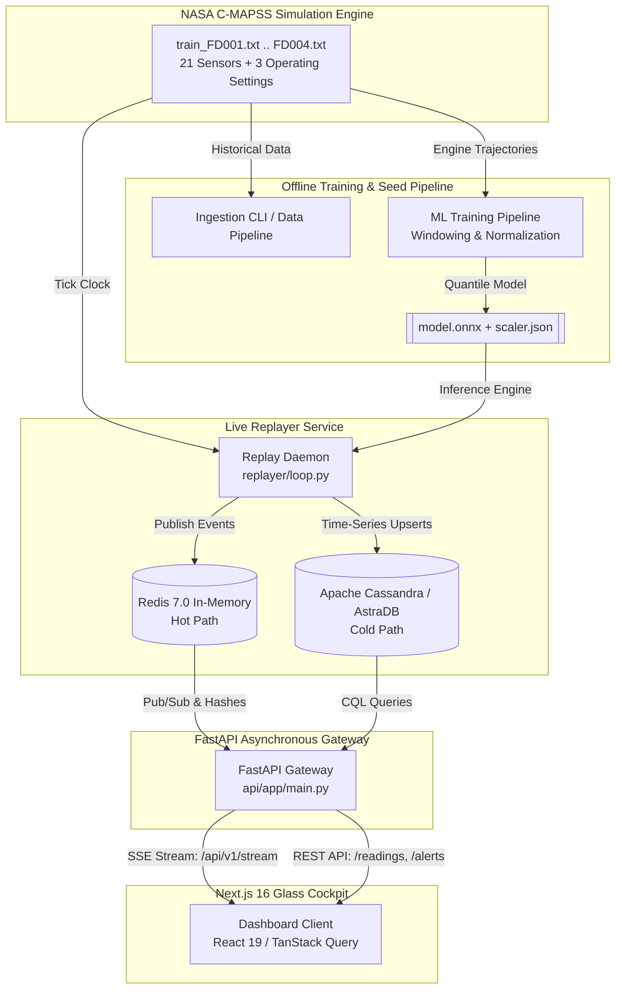

# VaneLoop ✈️
### Industrial-Grade Aircraft Turbofan Fleet Health Monitoring & RUL Prognostics

[](https://vane-loop.vercel.app)
[](https://vaneloop-api.onrender.com/healthz)
[](https://python.org)
[](https://nextjs.org)
[](https://cassandra.apache.org)
[](https://upstash.com)

> ⚠️ **Safety & Airworthiness Disclaimer**: VaneLoop operates exclusively on **simulated NASA C-MAPSS data**. It is an engineering demonstration and prognostics testbed designed to demonstrate dual-tier NoSQL data engineering, distributed streaming, and quantile machine learning. It is **not certified** and must **never** be used for real-world aviation maintenance, dispatch, or airworthiness release decisions.

---

## 📖 Table of Contents
1. [Project Overview](#-project-overview)
2. [End-to-End System Architecture](#-end-to-end-system-architecture)
3. [The Aeronautical Domain & Sensor Physics](#-the-aeronautical-domain--sensor-physics)
4. [Prognostics & Machine Learning Engine](#-prognostics--machine-learning-engine)
5. [Storage Architecture: Hot Path vs. Cold Path](#-storage-architecture-hot-path-vs-cold-path)
6. [Real-Time Streaming & Replay Engine](#-real-time-streaming--replay-engine)
7. [User Experience & Workflows](#-user-experience--workflows)
8. [Developer Setup & Deployment Guide](#-developer-setup--deployment-guide)
9. [Database Schema & Benchmark Verifications](#-database-schema--benchmark-verifications)
10. [Data Provenance & Acknowledgements](#-data-provenance--acknowledgements)

---

## 🎯 Project Overview

Commercial aircraft gas turbine engines are among the most safety-critical assets in modern infrastructure. An unexpected engine failure at altitude costs airlines millions in delays, unscheduled depot repairs, and regulatory penalties. Traditional maintenance relies on fixed flight-hour intervals, which either wastes remaining component life or misses early-onset anomalies.

**VaneLoop** is a real-time, end-to-end predictive maintenance platform. It ingests continuous multivariate sensor streams from a fleet of commercial turbofans, predicts Remaining Useful Life (RUL) with calibrated uncertainty bounds ($p_{10}, p_{50}, p_{90}$), detects anomalous degradation trends before threshold boundaries are reached, and renders the entire fleet in an instrument-panel glass cockpit UI.

### Key Capabilities
- **Real-Time Fleet Streaming**: Simulates flight-by-flight degradation across 100+ engines simultaneously via Server-Sent Events (SSE).
- **Quantile RUL Prognostics**: Evaluates piece-wise linear degradation curves with $80\%$ confidence intervals ($p_{10}$ to $p_{90}$) using ONNX microsecond inference.
- **Dual-Tier NoSQL Foundation**: Leverages in-memory Redis for sub-millisecond hot-path fleet state and Apache Cassandra / DataStax Astra DB for petabyte-scale cold-path time-series telemetry.
- **Instrument-Grade Glass Cockpit Interface**: Built with Next.js 16, React 19, Tailwind CSS v4, and Recharts, adhering to FAA/SAE human factor design principles (no color-only status, high-density monospace telemetry, instant visual hierarchy).
- **Zero-Cloud-Cost Deployment**: Architected to operate in production on 100% free cloud tiers (Vercel Edge, Render Web Docker with in-container caching, Astra DB serverless).

---

## 🏗️ End-to-End System Architecture

The VaneLoop pipeline is engineered around the **Lambda / Hybrid-Tier Storage Pattern**, cleanly separating high-velocity ingestion from deep analytical queries.



### Architectural Tiers Explained
1. **The Replayer Daemon (`replayer/loop.py`)**: Advances engine operational cycles in lockstep (configurable 1000ms–2000ms tick rate). For every engine, it computes running sensor baselines, feeds the latest window to the ONNX model, evaluates alert rules, and multicasts updates to Redis and Cassandra.
2. **The Hot Path (In-Memory Redis)**:
   - Holds fleet snapshot hashes (`vl:{ds}:engine:{unit}:status`).
   - Maintains real-time RUL rankings in a Redis Sorted Set (`vl:{ds}:fleet:by_rul`).
   - Publishes cycle updates to `vl:{ds}:ticks` for direct fan-out to active browser tabs.
3. **The Cold Path (Apache Cassandra / Astra DB)**:
   - Persists immutable multi-sensor telemetry history across every engine flight cycle.
   - Designed with strict query-first partition keys (zero `ALLOW FILTERING`).
4. **The Gateway (FastAPI)**:
   - Exposes clean OpenAPI contracts.
   - Pushes real-time SSE streams over persistent HTTP/2 connections.
5. **The Presentation Layer (Next.js 16 App Router)**:
   - Consumes Server-Sent Events, updating in-memory TanStack Query caches surgically to prevent DOM reflow thrashing.

---

## ✈️ The Aeronautical Domain & Sensor Physics

VaneLoop models high-bypass commercial turbofans operating under NASA C-MAPSS simulations. Understanding the physical sensor telemetry is central to interpreting engine condition and health degradation.

```
                             [ ENGINE INLET ]
                                    │
                                  [ FAN ] ──────> Bypass Air Flow (BPR ~80% Thrust)
                                    │
                        [ LPC: Low Pressure Compressor ]  ==> T24 (LPC Temp)
                                    │
                        [ HPC: High Pressure Compressor ] ==> T30 (HPC Temp), P30 (Combustor Press)
                                    │
                        [ COMBUSTOR ] <────────────────────── phi (Fuel/Air Ratio)
                                    │
                        [ HPT: High Pressure Turbine ]   ==> W31 (Coolant Bleed)
                                    │
                        [ LPT: Low Pressure Turbine ]    ==> T50 (Exhaust Gas Temp / EGT)
                                    │
                             [ CORE NOZZLE ]
```

### Sensor Telemetry Glossary

| C-MAPSS ID | SAE Symbol | Descriptive Engineering Name | Unit | Physical Role & Degradation Behavior |
| :---: | :---: | :--- | :---: | :--- |
| `s2` | **T24** | LPC Outlet Temperature | °R | Total temperature exiting low-pressure compressor. Drifts upward as compressor fouling and blade roughness increase. |
| `s3` | **T30** | HPC Outlet Temperature | °R | Temperature exiting high-pressure compressor. Rises as aerodynamic efficiency drops and more compression work is required. |
| `s4` | **T50** | Exhaust Gas Temp (LPT Outlet / EGT) | °R | **Most critical single health indicator in aviation.** As turbine clearance widens and blades degrade, EGT spikes to deliver requested thrust. |
| `s7` | **P30** | HPC Delivery Pressure | psia | Static/total pressure at combustor inlet. Decreases as compressor erosion degrades pressure ratio. |
| `s8` | **Nf** | Physical Fan Speed | RPM | Rotational speed of the low-pressure spool/fan shaft. |
| `s9` | **Nc** | Physical Core Speed | RPM | Rotational speed of the high-pressure spool. Core speeds shift upward to compensate for lost aerodynamic work. |
| `s11` | **Ps30** | Static Combustor Pressure | psia | Static pressure measurement inside the combustor outer casing. |
| `s12` | **phi** | Fuel-to-Air Ratio | — | Ratio of fuel mass flow rate to combustor airflow. Increases as thermal efficiency degrades. |
| `s13` | **NRf** | Corrected Fan Speed | RPM | Fan shaft RPM normalized for ambient inlet conditions ($\theta = T / T_{ref}, \delta = P / P_{ref}$). |
| `s14` | **NRc** | Corrected Core Speed | RPM | Core shaft RPM normalized for ambient thermodynamic state. |
| `s15` | **BPR** | Bypass Ratio | — | Ratio of bypass air mass flow to engine core flow ($\dot{m}_{bypass} / \dot{m}_{core}$). Drops as core passage expands. |
| `s17` | **htBleed** | Bleed Enthalpy | — | Specific enthalpy of bleed air taken from compressor for cabin environmental control systems. |
| `s20` | **W31** | HPT Coolant Bleed Flow | lbm/s | High-pressure cooling airflow diverted across high-pressure turbine nozzles to prevent structural blade creep. |
| `s21` | **W32** | LPT Coolant Bleed Flow | lbm/s | Cooling airflow diverted across low-pressure turbine stator assemblies. |

> **Units Note**: Temperatures are in degrees Rankine ($^\circ\text{R}$), where $^\circ\text{F} = ^\circ\text{R} - 459.67$. A reading of $642^\circ\text{R} \approx 182^\circ\text{F} \approx 83^\circ\text{C}$. Pressures are in pounds per square inch absolute (psia).

---

## 🧠 Prognostics & Machine Learning Engine

### 1. Mathematical Formulation of Remaining Useful Life (RUL)
For each engine $u$ observed at flight cycle $t$, let $T_u$ denote the unknown cycle of complete functional failure:

$$\text{RUL}(u, t) = T_u - t$$

#### The Piecewise Linear Degradation Target
In early life (cycles $1$ to $\sim 90$), jet engine components exhibit negligible structural wear. Sensor readings fluctuate solely due to operational adjustments and noise. Training a regressor to predict values above 125 cycles causes severe overfitting on noise. Following industry standards (Heimes 2008, Saxena 2008), the training target is capped:

$$y_t = \min\left(T_u - t, 125\right)$$

In the dashboard, any engine with $y_t \ge 125$ is presented with transparent humility as **$\ge 125\text{ cycles}$** rather than displaying false precision.

```
RUL (Cycles)
 125 ───┬───────────────────────────┐ (Plateau: Capped Target RUL)
        │                           │
  75 ───┼                           └───┐ (Degradation Phase)
        │                               └───┐
   0 ───┴───────────────────────────────────┴───► Flight Cycles
        0                          80      140  Failure
```

### 2. Quantile Regression for Calibrated Uncertainty
Point predictions ($\hat{y}$) are dangerous in aviation dispatch. If an algorithm predicts $40$ cycles but the engine fails at cycle $22$, catastrophic in-flight shutdown can occur. 

VaneLoop estimates a conditional probability distribution using **Quantile Regression**:
- **$p_{10}$ (Lower Bound / 10th Percentile)**: $\mathbb{P}(y < \hat{y}_{p10}) = 0.10$. Used by fleet maintenance planners for risk-averse inspection scheduling.
- **$p_{50}$ (Median / 50th Percentile)**: Expected life under standard operational wear.
- **$p_{90}$ (Upper Bound / 90th Percentile)**: $\mathbb{P}(y < \hat{y}_{p90}) = 0.90$.

Quantile heads are trained minimizing the **Pinball Loss** (asymmetric linear loss):

$$\mathcal{L}_\tau(y, \hat{y}) = \max\left( \tau (y - \hat{y}), (\tau - 1)(y - \hat{y}) \right)$$

where $\tau \in \{0.10, 0.50, 0.90\}$.

### 3. Feature Engineering Pipeline (`ml/preprocess.py`)
- **Informative Sensor Selection**: Only the 14 variance-carrying sensors are retained (`s2, s3, s4, s7, s8, s9, s11, s12, s13, s14, s15, s17, s20, s21`). Constant sensors (`s1, s5, s10, s16, s18, s19`) are dropped.
- **Multi-Scale Rolling Window Statistics**: For each sensor $s$, `generate_rolling_features` extracts temporal dynamics (rolling mean and standard deviation) across three multi-scale sliding windows ($W \in \{5, 10, 30\}$ cycles):
  $$\mu_{s, W}(t) = \frac{1}{W} \sum_{k=0}^{W-1} s(t - k), \quad \sigma_{s, W}(t) = \sqrt{\frac{1}{W - 1} \sum_{k=0}^{W-1} (s(t-k) - \mu_{s, W}(t))^2}$$
- **Engine-Level Group Splitting**: When training and evaluating (`ml/train.py`), splits are made strictly by **Engine Unit ID** (`GroupShuffleSplit` grouped by `dataset_unit`). Row-level random splits leak trajectory history and are strictly forbidden in industrial prognostics.
- **ONNX Export (`ml/export.py`)**: All three trained LightGBM quantile regressors (`p10`, `p50`, `p90`) are exported to ONNX format (`ml/artifacts/model_p10.onnx`, `model_p50.onnx`, `model_p90.onnx`) via `skl2onnx` and `onnxmltools` for low-latency CPU inference in `replayer/loop.py`.

### 4. Rule-Based Alert Engine & Hysteresis (`api/app/policy.py`)
To prevent alert flickering between Nominal and Warning, transitions use threshold hysteresis and streak counters:

$$\text{State}(t) = \begin{cases} 
\text{Warming Up} & \text{if } t \le 30 \\
\text{Critical} & \text{if } \hat{y}_{p10} \le 30 \\
\text{Warning} & \text{if } \hat{y}_{p50} \le 70 \text{ or } \hat{y}_{p10} \le 50 \\
\text{Nominal} & \text{otherwise}
\end{cases}$$

- **Sensor Drift Detection**: Z-score relative to the engine's first 20 baseline cycles:
  $$Z_s(t) = \frac{\bar{s}_{recent} - \bar{s}_{baseline}}{\sigma_{s, baseline}}$$
  If $|Z_s(t)| > 3.0$ for 5 consecutive cycles, an anomaly alert is registered indicating compressor or turbine clearance degradation.

---

## 💾 Storage Architecture: Hot Path vs. Cold Path

A fundamental design goal of VaneLoop is demonstrating proper database selection for high-velocity IoT streams.

| Metric | Hot Path: Redis (Upstash Serverless / In-Container) | Cold Path: Apache Cassandra / Astra DB |
| :--- | :--- | :--- |
| **Primary Responsibility** | Current fleet status, live SSE stream, sorted rankings | Immutable sensor time-series history, audits, alerts |
| **Target Latency** | $< 1\text{ ms}$ (local) / $\sim 10\text{ ms}$ (Upstash cloud) | $10\text{--}25\text{ ms}$ |
| **Architecture** | **Upstash Serverless Redis** (HTTP/TLS, pay-per-request) or container-managed Redis daemon | Distributed wide-column cluster partitioned by `((dataset, unit), cycle)` |
| **Data Structure** | In-Memory Hashes, Sorted Sets (ZSET), Pub/Sub channels | Wide-column distributed tables with clustering keys |
| **Write Pattern** | Overwrite current state on tick | Append-only sequential time-series writes |
| **Scaling Characteristic** | Memory-bounded ($O(N)$ engines) | Horizontally partitioned over commodity nodes ($O(N \times T)$ cycles) |

> 💡 **Why Upstash Redis vs. In-Container Redis?**
> - **Upstash Redis**: Serverless Redis with native TLS (`rediss://`), zero infrastructure management, and automatic persistence. Ideal for standard cloud environments.
> - **In-Container Daemon (`redis-server`)**: On strict zero-dollar free tiers (like Render Free with 512MB RAM), a continuous multi-engine simulation loop ticking at 1000ms can execute $>500,000$ commands in minutes, exhausting free serverless quotas. VaneLoop's Docker container includes a local, 48MB LRU-capped `redis-server` daemon fallback that allows unlimited simulation ticks without incurring SaaS fees.

### Cassandra Partitioning Strategy (`infra/cassandra/schema.cql`)
Cassandra query patterns require table schemas matching the exact queries executed:

```sql
-- Query 1: Fetch recent 200 cycles of telemetry for a single engine (Newest First)
CREATE TABLE IF NOT EXISTS engine_readings (
  dataset text,
  unit int,
  cycle int,
  op1 double, op2 double, op3 double,
  s1 double, s2 double, s3 double, s4 double, s5 double,
  s6 double, s7 double, s8 double, s9 double, s10 double,
  s11 double, s12 double, s13 double, s14 double, s15 double,
  s16 double, s17 double, s18 double, s19 double, s20 double, s21 double,
  rul_true int,
  PRIMARY KEY ((dataset, unit), cycle)
) WITH CLUSTERING ORDER BY (cycle DESC);

-- Query 2: Bounded Partitioning for Fleet-Wide Sensor Trend Analysis
CREATE TABLE IF NOT EXISTS sensor_readings_by_sensor (
  dataset text,
  sensor text,
  cycle_bucket int, -- floor(cycle / 50) prevents partition overflow at scale
  cycle int,
  unit int,
  value double,
  PRIMARY KEY ((dataset, sensor, cycle_bucket), cycle, unit)
);
```

### Redis Key Hierarchy
- `vl:{ds}:engine:{unit}:status` $\rightarrow$ `HASH`: Contains `{cycle, state, rul_p10, rul_p50, rul_p90, updated_at}`.
- `vl:{ds}:fleet:by_rul` $\rightarrow$ `ZSET`: Member `unit`, Score $\hat{y}_{p50}$. Allows instant $O(\log N)$ retrieval of lowest-RUL engines across thousands of aircraft.
- `vl:{ds}:ticks` $\rightarrow$ `PUB/SUB`: Channel multicasting real-time engine ticks to FastAPI SSE connection pools.

---

## ⚡ Real-Time Streaming & Replay Engine

The background replayer (`replayer/loop.py`) operates as a flight simulator daemon.

```python
# replayer/loop.py (Core Simulation Loop)
for tick_idx in count():
    for ds in datasets:
        for unit in fleet[ds]:
            row = dataset_reader.next_cycle(unit)
            
            # 1. Microsecond Quantile Inference (ONNX)
            features = extract_window_features(unit, row)
            p10, p50, p90 = onnx_session.predict(features)
            
            # 2. Evaluate Policy & Drift Rules
            state = evaluate_status_policy(p10, p50)
            alerts = check_sensor_drift(unit, row)
            
            # 3. Buffer Hot-Path Writes
            redis_pipeline.hset(f"vl:{ds}:engine:{unit}:status", mapping={...})
            redis_pipeline.zadd(f"vl:{ds}:fleet:by_rul", {str(unit): p50})
            
        # 4. Multicast Tick to Active Browser Streams
        redis_pipeline.publish(f"vl:{ds}:ticks", json.dumps(tick_events))
        redis_pipeline.execute()
    
    sleep(REPLAY_TICK_MS / 1000.0)
```

### Server-Sent Events (SSE) Protocol
Clients connect to `/api/v1/stream?dataset=FD001` with standard `EventSource`:
```http
HTTP/1.1 200 OK
Content-Type: text/event-stream
Cache-Control: no-cache
Transfer-Encoding: chunked

event: tick
data: {"type": "tick", "unit": 85, "cycle": 142, "state": "Warning", "rul_p50": 46.2, "rul_p10": 31.0, "rul_p90": 61.2}

event: alert
data: {"type": "alert", "severity": "Critical", "unit": 85, "rule": "RUL_CRITICAL", "message": "RUL p10 dropped below 30 cycles"}
```

---

## 🖥️ User Experience & Workflows

The frontend dashboard adheres strictly to the **Instrument-Panel Minimalism** specification.

```
+─────────────────────────────────────────────────────────────────────────────+
|  ✈️ Aircraft Engine Health     ● Simulated data · live     [Dataset: FD001] |
+─────────────────────────────────────────────────────────────────────────────+
|  Fleet Overview       Nominal: 72   |   Warning: 18   |   Critical: 10      |
+─────────────────────────────────────────────────────────────────────────────+
|  [ FD001-085 ]  [ FD001-012 ]  [ FD001-044 ]  [ FD001-002 ]  [ FD001-091 ]  |
|  Cycle: 142     Cycle: 198     Cycle: 89      Cycle: 45      Cycle: 110     |
|  RUL: 46 cyc    RUL: 12 cyc    RUL: 88 cyc    RUL: ≥125 cyc  RUL: 62 cyc    |
|  [ Warning ]    [ Critical ]   [ Nominal ]    [ Nominal ]    [ Warning ]    |
+─────────────────────────────────────────────────────────────────────────────+
```

### Primary Screens
1. **Fleet Overview (`/`)**:
   - Real-time 100-engine grid showing status pills, cycle count, and RUL estimation.
   - Global status counters (Nominal / Warning / Critical) synchronized with server state.
   - Dynamic sorting: Sort by lowest RUL ascending, Unit ID, or Cycle count.
2. **Engine Detail (`/engine/[id]`)**:
   - **Exhaust Gas Temp & Sensor Trajectory**: Recharts line visualization showing historical degradation across cycles with raw engineering units (°R, psia, RPM).
   - **RUL Trajectory & Uncertainty Band**: Plotted $p_{10}$ to $p_{90}$ shaded envelope overlaid against ground-truth lifecycle decay.
   - **Condition Monitoring / Root-Cause Attribution**: Automatic statistical breakdown identifying which specific sensors exhibited the greatest statistical deviation ($\Delta\%$) from baseline.
   - **Historical Sensor Telemetry Table**: Monospace table displaying cycles descending with formatted readouts.
3. **Alerts Feed (`/alerts`)**:
   - Fleet-wide audit log filtering by severity and rule type.
4. **Benchmark & Storage Verification (`/benchmark`)**:
   - Live visualizations comparing latency and throughput between the Cassandra cold store and Redis hot path.

---

## 🛠️ Developer Setup & Deployment Guide

VaneLoop can be run locally using Docker Compose or deployed to production cloud platforms.

### Local Development Setup

#### Prerequisites
- Python 3.13+ with [`uv`](https://github.com/astral-sh/uv) package manager
- Node.js 20+ and `npm`
- Docker & Docker Compose

#### 1. Clone & Synchronize Dependencies
```bash
git clone https://github.com/git791/VaneLoop.git
cd VaneLoop

# Install backend dependencies
uv sync

# Install frontend dependencies
cd frontend
npm install
cd ..
```

#### 2. Start Local Storage Infrastructure
```bash
docker compose -f infra/docker-compose.yml up -d
```
This spins up:
- Apache Cassandra on `localhost:9042`
- Redis on `localhost:6379`

#### 3. Ingest Data & Run Local Server
```bash
# Fetch NASA C-MAPSS dataset (automatically downloads and extracts)
uv run python scripts/fetch_data.py

# Run Cassandra migrations
uv run python -m api.app.cli migrate

# Ingest historical training telemetry into Cassandra
uv run python -m api.app.cli ingest --dataset FD001

# Start FastAPI backend (port 8000)
uv run uvicorn api.app.main:app --host 0.0.0.0 --port 8000

# In a separate terminal: Start Next.js frontend (port 3000)
cd frontend
npm run dev
```

Visit `http://localhost:3000` to interact with the local dashboard.

---

### Production Deployment Architecture (100% Free Tier)

VaneLoop is configured to run in production with zero recurring costs:

```
+───────────────────────────+
|      Vercel (Hobby)       | ──> Next.js 16 Edge CDN Frontend
+─────────────┬─────────────+
              │ HTTPS / SSE
              ▼
+───────────────────────────+
|     Render.com (Free)     | ──> Docker Web Service (api/Dockerfile)
|                           |     ├─ In-Container Redis (48MB LRU cap)
|                           |     ├─ Live Replayer Loop (replayer/loop.py)
|                           |     └─ FastAPI ASGI Server (Uvicorn :10000)
+─────────────┬─────────────+
              │ CQL (Secure Connect Bundle)
              ▼
+───────────────────────────+
|  DataStax Astra DB (Free) | ──> Serverless Cassandra Time-Series Database
+───────────────────────────+
```

#### Environment Variables Configuration (`.env`)
```bash
# Storage Backend
VANELOOP_STORE=cassandra
CASSANDRA_KEYSPACE=default_keyspace
CASSANDRA_USERNAME=token
CASSANDRA_PASSWORD=AstraCS:...your_token...

# Astra DB SSL Secure Connect Bundle (Base64-encoded)
ASTRA_DB_BUNDLE_BASE64=UEsDBBQAAAAIA...

# Redis Connection (Defaults to local in-container Redis in production)
REDIS_URL=redis://127.0.0.1:6379

# Frontend Cross-Origin Resource Sharing
CORS_ALLOW_ORIGINS=https://vane-loop.vercel.app,http://localhost:3000

# Replay Configuration
REPLAY_MODE=train
REPLAY_TICK_MS=2000
```

---

## 📊 Database Schema & Benchmark Verifications

All model evaluation and storage benchmark metrics are deterministically generated and committed under `benchmarks/results/*.json` and `ml/artifacts/metrics.json`. To reproduce these numbers locally from raw data:

```bash
# 1. Train LightGBM quantile models (p10, p50, p90), evaluate on test_FD001..FD004, and export ONNX artifacts
uv run python -m ml.train

# 2. Run storage ingestion & query latency benchmarks and write benchmarks/results/FD001..FD004.json
uv run python -m benchmarks.runner
```

### Verified Results (`benchmarks/results/*.json` & `ml/artifacts/metrics.json`)

| Dataset | Test Engines | Train Rows Ingested | Ingest Time (s) | Fleet Query Latency (ms) | Cold-Path Q1 Latency (ms) | RUL Accuracy (%) | Test RMSE (cycles) | Test MAE (cycles) | 80% Band Coverage | NASA PHM08 Score |
| :---: | :---: | :---: | :---: | :---: | :---: | :---: | :---: | :---: | :---: | :---: |
| **FD001** | 100 | 20,631 | 6.86 s | 1.99 ms | 2.66 ms | **88.8%** | **20.47** | 14.00 | **85.0%** | 2,095.2 |
| **FD002** | 259 | 53,759 | 13.13 s | 4.69 ms | 1.82 ms | **86.6%** | **23.59** | 16.82 | **87.3%** | 9,269.0 |
| **FD003** | 100 | 24,720 | 3.97 s | 2.15 ms | 2.43 ms | **89.8%** | **19.18** | 12.68 | **75.0%** | 2,131.3 |
| **FD004** | 248 | 61,249 | 14.42 s | 5.33 ms | 2.54 ms | **87.1%** | **22.66** | 16.19 | **85.9%** | 4,077.9 |

---

## 📜 Data Provenance & Acknowledgements

* **Dataset Citation**: NASA Commercial Modular Aero-Propulsion System Simulation (C-MAPSS) dataset. Originally generated by A. Saxena, K. Goebel, D. Simon, and N. Eklund (2008), *"Damage Propagation Modeling for Aircraft Engine Run-to-Failure Simulation"*, Prognostics and Health Management International Conference (PHM08).
* **Open Source Frameworks**: Built using FastAPI, Apache Cassandra Python Driver, PyTorch/ONNX, Next.js, Lucide Icons, and Recharts.
* **License**: Code released under the [MIT License](LICENSE). Telemetry datasets remain subject to NASA open data guidelines.